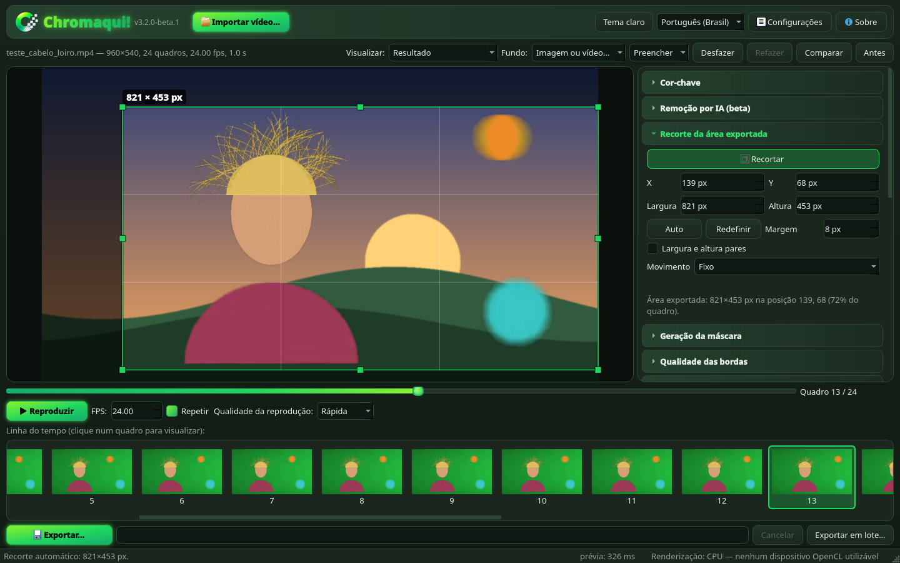
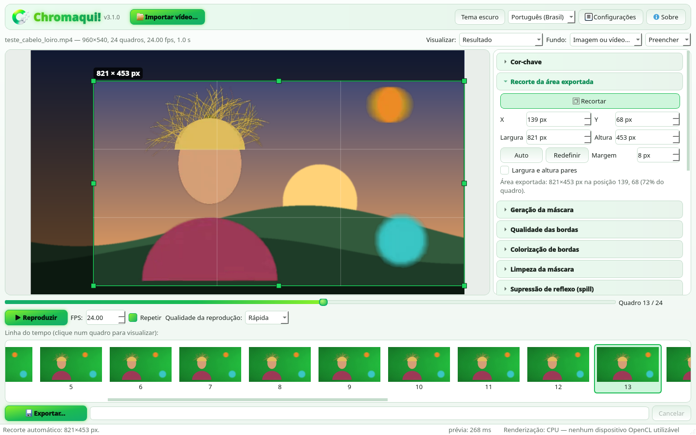
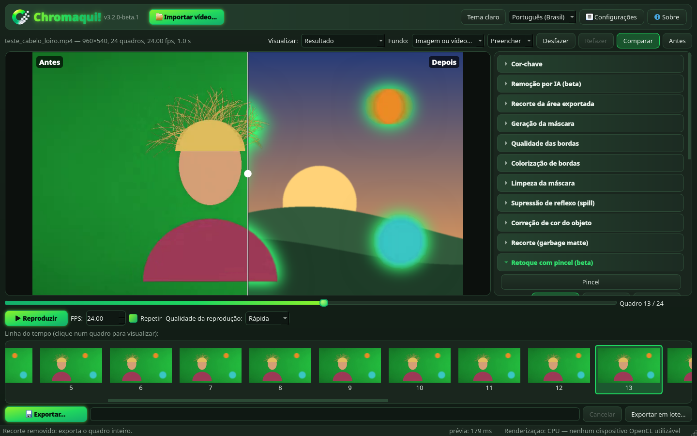
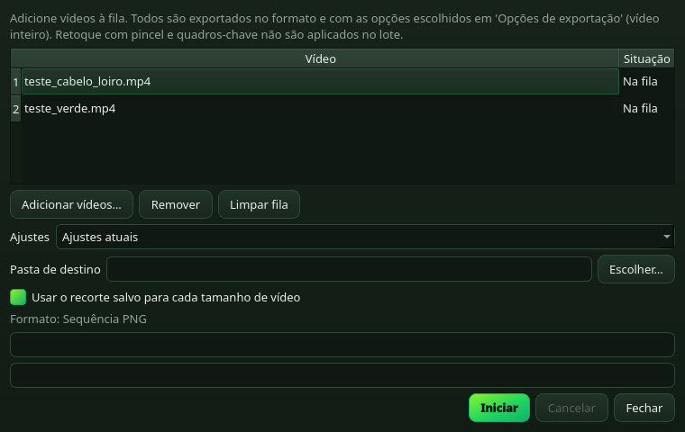

<p align="center">
  
</p>

<h1 align="center">Chromaqui!</h1>

<p align="center">
  Remova o fundo verde ou azul (chroma key) de vídeos e exporte quadros e animações com transparência.<br>
  <b>PNG · TGA · TIFF · WebP · GIF · APNG · WebM VP9 (alfa) · ProRes 4444 (alfa)</b>
</p>

<p align="center">
  <a href="https://github.com/cleitinhodev/chromaqui/releases/latest"><b>Baixar</b></a> ·
  <a href="https://github.com/cleitinhodev/">Repositório</a> ·
  <a href="https://www.bugzinho.com/">Site</a> ·
  <a href="https://www.bugzinho.com/donate">Doar 💚</a> ·
  <a href="#english">English</a>
</p>

| Tema escuro | Tema claro |
|---|---|
|  |  |
|  |  |
|  |  |
|  |  |

## Download

Baixe a versão mais recente em **[Releases](https://github.com/cleitinhodev/chromaqui/releases/latest)**.

### Windows

- **Chromaqui-Windows.zip** — pasta com `Chromaqui.exe` (abre mais rápido; recomendado).
- **Chromaqui-Windows-onefile.zip** — um único `Chromaqui.exe` (mais prático, demora alguns segundos para abrir).

Não precisa instalar nada: descompacte e execute. Windows 10/11 64 bits.
Na primeira execução o SmartScreen pode avisar ("Executar assim mesmo"), porque o executável não é assinado.

### Linux (x86_64)

Versão nativa, com os mesmos recursos (ffmpeg, IA e GPU/OpenCL inclusos). Funciona em distribuições com
glibc 2.35 ou mais nova (Ubuntu 22.04+, Debian 12+, Fedora 36+, Mint 21+, openSUSE Leap 15.5+, Arch…),
em X11 e Wayland.

- **Chromaqui-Linux-x86_64.AppImage** — um arquivo só (recomendado):

  ```bash
  chmod +x Chromaqui-Linux-x86_64.AppImage
  ./Chromaqui-Linux-x86_64.AppImage
  ```

  O AppImage usa o **FUSE** para se montar (só o comando `fusermount3`/`fusermount`, do pacote `fuse3` ou
  `fuse`, que já vem na maioria das distribuições; **não** precisa do antigo `libfuse2`). Se aparecer
  "Cannot mount AppImage" / "fusermount: not found", instale `fuse3` (`sudo apt install fuse3`,
  `sudo dnf install fuse3`, `sudo pacman -S fuse3`) **ou** rode sem FUSE:
  `./Chromaqui-Linux-x86_64.AppImage --appimage-extract-and-run`.
- **Chromaqui-Linux-x86_64.tar.gz** — pasta portátil (não precisa de FUSE):

  ```bash
  tar xzf Chromaqui-Linux-x86_64.tar.gz
  cd Chromaqui-Linux-x86_64
  ./Chromaqui/Chromaqui
  ./install-desktop.sh      # opcional: adiciona ao menu de aplicativos (só para o seu usuário)
  ```

Configurações e logs ficam em `~/.config/Chromaqui` (ou `$XDG_CONFIG_HOME/Chromaqui`); os modelos de IA em
`~/.local/share/Chromaqui/models`. Em Wayland o programa usa o Wayland nativo e, se não der, o X11 (XWayland);
para forçar o X11: `QT_QPA_PLATFORM=xcb ./Chromaqui-Linux-x86_64.AppImage`.

> 🧪 **Versão de testes:** a **3.2.0-beta.2** (Windows e Linux) está nas Releases como *pre-release* (recursos marcados
> **(beta)** abaixo). A versão estável recomendada continua sendo a **3.1.0** (marcada como *Latest*).

Se algo der errado, os detalhes ficam em `%APPDATA%\Chromaqui\logs` (Windows) ou `~/.config/Chromaqui/logs`
(Linux) — arquivos `erros.log` e `travamento.log`.

## Recursos

- **Chroma key de qualidade**: verde, azul ou qualquer cor (conta-gotas na prévia); tolerância, faixa de
  transição, realces/sombras, pedestal; **refinamento de bordas** (guided filter), descontaminação,
  suavização de croma (H.264 4:2:0), **colorização de bordas**, supressão de reflexo (spill),
  limpeza da máscara, correção de cor e recorte (garbage matte). Presets em `.json`.
- **Prévia e reprodução**: resultado, máscara, original, lado a lado; play/pause com FPS ajustável;
  linha do tempo com miniaturas.
- **Recorte da área exportada**: ative **Recortar** e desenhe na prévia a área que vai para o arquivo
  (arraste para criar, alças para ajustar, meio para mover) ou digite X/Y/Largura/Altura em pixels do vídeo
  original. **Auto** encontra sozinho a menor área que contém o objeto em 30 quadros do vídeo (mais a
  margem). O recorte vale para **todos os quadros e todos os formatos** (e para o fundo incluído), é
  aplicado antes da escala, deixa a exportação mais rápida e fica salvo para vídeos do mesmo tamanho.
  Opção de largura/altura pares (WebM e ProRes sempre usam pares). **Redefinir** volta ao quadro inteiro.
- **Recorte que segue o objeto** *(beta, 3.2)*: *Movimento* = **Seguir o objeto** (a área acompanha o
  objeto, com suavização) ou **Quadros-chave** (você posiciona a área em alguns quadros e ela é interpolada).
- **Exportar só um trecho**: campos *De / Até / 1 a cada N* em "Opções de exportação".
- **Retoque com pincel** *(beta)*: Manter / Remover / Borracha direto na prévia (todos os quadros ou só um).
- **Remoção por IA, sem tela verde** *(beta)*: onnxruntime na CPU; o modelo (MODNet 26 MB ou U²-Net
  pequeno 4,6 MB) é baixado uma vez, no primeiro uso, para `%APPDATA%\Chromaqui\models`
  (Linux: `~/.local/share/Chromaqui/models`).
- **Sombra projetada / brilho neon** atrás do objeto *(beta)*, na prévia e opcionalmente no arquivo.
- **Desfazer/Refazer** (Ctrl+Z / Ctrl+Y) e **comparar antes/depois** (prévia dividida e botão "Antes") *(beta)*.
- **Exportação em lote** *(beta)*: vários vídeos com os ajustes atuais ou um preset.
- **Verificação de atualizações** *(beta)*: avisa quando há versão nova nas Releases (desligável).
- **Fundo de teste**: xadrez, preto, branco, cor, **imagem ou vídeo** (preencher/ajustar/esticar).
  Só vai para o arquivo se você marcar **"Incluir fundo na exportação"** (resultado opaco).
- **Exportação** (sempre com transparência, respeitando intervalo, passo "1 a cada N", escala e FPS):

  | Formato | Observações |
  |---|---|
  | Sequência PNG | 8 ou 16 bits, compressão 0–9 |
  | Sequência TGA / TIFF / WebP | TIFF com LZW (8 bits) ou Deflate (16 bits), alfa marcado corretamente |
  | GIF animado | transparência de 1 bit: limiar de alfa, nº de cores, qualidade da paleta, pontilhado e **cor de borda (matte)** para bordas sem serrilhado |
  | WebP animado / APNG | alfa completo (8 bits), repetições |
  | WebM VP9 | `yuva420p` com alfa (navegadores, OBS, editores) |
  | MOV ProRes 4444 | `yuva444p10le` com alfa (Premiere, DaVinci Resolve, Final Cut) |
  | Sprite sheet *(beta)* | PNG + JSON do TexturePacker (hash/array), colunas, espaçamento, tamanho máximo e *trim* |

  WebM/ProRes/WebP/APNG usam o **ffmpeg embutido** (imageio-ffmpeg); nada para instalar.
- **Temas Claro/Escuro** com gradientes nas cores do logo, **animações** e **brilho neon**
  (desligáveis em ⚙ Configurações). Tudo fica salvo entre sessões.
- **Idiomas** (trocados **na hora**, sem perder o vídeo nem os ajustes): Português (Brasil) — padrão —,
  English, Español, Français, Deutsch, Italiano, 日本語, 简体中文.
- **GPU**: em Configurações → Renderização, escolha **Automático / CPU / GPU (OpenCL)**. O Automático só usa
  a placa de vídeo se ela existir **e** passar num teste de conferência; senão volta para a CPU com segurança.
  O resultado é o mesmo — muda só a velocidade. A barra de status mostra o backend em uso e o tempo da prévia.

## Rodar a partir do código

```bash
python -m venv .venv
.venv\Scripts\activate            # Windows  (Linux/macOS: source .venv/bin/activate)
pip install -r requirements.txt
python run_chromaqui.py
```

No Windows também dá para dar dois cliques em `executar.bat`.

### Auto-teste

```bash
python run_chromaqui.py --self-test caminho\video.mp4 pasta_saida
# ou no executável:  Chromaqui.exe --self-test video.mp4 pasta_saida
```

Testa tema, efeitos, ícone, Sobre/Configurações, todos os idiomas, presets, visualizações, CPU/GPU,
fundo, reprodução, **todos os formatos** (conferidos com ffprobe/Pillow), fundo na exportação e cancelar.
Resultado em `pasta_saida/selftest.log`. Outros testes: `tests/test_core.py`, `tests/test_exporters.py`,
`tests/test_gpu.py`, `tests/test_playback.py` (rode `tests/make_soft_video.py` antes).

### Gerar o executável

```bash
pip install -r requirements-build.txt
python tools/build_exe.py --both --zip
```

Gera `dist/Chromaqui/Chromaqui.exe`, `dist1/Chromaqui.exe` e os dois `.zip`.

No Linux (de preferência numa distribuição antiga, para funcionar nas mais novas; o CI usa Ubuntu 22.04):

```bash
pip install -r requirements-linux.txt
python tools/build_linux.py --package     # Chromaqui-Linux-x86_64.AppImage e .tar.gz
```

O workflow `.github/workflows/release.yml` faz tudo isso no GitHub (Windows e Linux, com testes e auto-teste
dos executáveis) ao criar uma tag `v*` (ex.: `git tag v3.1.0 && git push origin v3.1.0`) e anexa os arquivos
à Release. Tags `-alpha`/`-beta`/`-rc` saem como *pre-release* e nunca viram a *Latest*.

### Trocar o logo / ícone

```bash
python tools/prepare_logo.py meu_logo.png assets/logo.png   # remove o fundo, recorta e deixa quadrado
python tools/make_icon.py assets/logo.png                    # icon.ico, favicon.ico, icons/*.png
python tools/logo_preview.py                                 # docs/logo_preview.png (claro/escuro)
```

`prepare_logo.py` aceita PNG transparente ou com fundo branco (remove só o branco ligado às bordas,
preservando partes brancas do desenho). As cores da interface derivam de uma única cor,
`ACCENT` em `chromaqui/theme.py`.

### Traduções

Arquivos em `assets/i18n/<idioma>.json` (chave = texto em português). Para incluir frases novas:
`python tools/extract_strings.py --template` (atualiza `_template.json` e mostra o que falta em cada idioma).
Os textos-fonte numerados ficam em `tools/i18n_src/*.txt` → `python tools/i18n_build.py`.

## Estrutura

```
chromaqui/      app.py (janela), app_extras.py (recursos 3.2), core.py (chroma key), exporters.py (formatos),
                ai.py (IA/onnxruntime), retouch.py (pincel), batch.py (lote), updates.py, gpu.py (OpenCL),
                theme.py, fx.py, i18n.py, dialogs.py, widgets.py, settings.py, selftest.py
assets/         logo.png, icon.ico, favicon.ico, icons/, i18n/
tools/          build_exe.py, make_icon.py, prepare_logo.py, logo_preview.py, extract_strings.py, i18n_build.py
tests/          testes e geradores de vídeos de teste
docs/           capturas de tela
```

## Licença

[MIT](LICENSE) — software livre.

---

## English

**Chromaqui!** is a free Windows app that removes green/blue (chroma key) backgrounds from videos and
exports frames and animations with transparency: **PNG/TGA/TIFF/WebP sequences, transparent animated GIF,
animated WebP, APNG, WebM VP9 with alpha and MOV ProRes 4444 with alpha** (bundled ffmpeg).

- High-quality keying: guided-filter edge refinement, despill, edge decontamination and colorization,
  chroma smoothing, matte cleanup, color correction, garbage matte, presets.
- **Export-area crop**: toggle **Crop** and draw the region on the preview (drag to create, handles to
  resize, middle to move) or type X/Y/Width/Height in source pixels. **Auto** finds the smallest region
  containing the subject across 30 frames (plus a margin). The crop applies to every frame and every format
  (and to the included background), is applied before scaling, speeds up export and is remembered per video
  size. Optional even width/height (always even for WebM/ProRes).
- **New in 3.2.0-beta.1 (pre-release; 3.1.0 stays the stable "Latest")**: crop that **follows the subject**
  or is interpolated between **keyframes**; **brush retouch** (keep/remove/eraser); **sprite sheet + TexturePacker
  JSON**; **batch export**; **AI background removal without a green screen** (onnxruntime, model downloaded on
  first use to `%APPDATA%\Chromaqui\models`, or `~/.local/share/Chromaqui/models` on Linux); **drop shadow / neon glow**; **undo/redo** and **before/after
  compare**; **update checker**. Range export (from/to/every N frames) was already available.
- Preview over checkerboard/solid color or **your own image/video background**; it is only baked into
  the export when **"Include background in export"** is checked.
- **Light/Dark themes**, optional animations and neon glow, **8 languages switchable at runtime**
  (pt-BR, en, es, fr, de, it, ja, zh-CN).
- **GPU rendering** via OpenCV OpenCL (Auto/CPU/GPU) with a verification test and safe CPU fallback.

**Download (Windows):** grab `Chromaqui-Windows.zip` (folder build, faster start) or
`Chromaqui-Windows-onefile.zip` (single exe) from **[Releases](https://github.com/cleitinhodev/chromaqui/releases/latest)**, unzip and run.

**Download (Linux x86_64, glibc 2.35+, X11 or Wayland):** native build with the same features.
- `Chromaqui-Linux-x86_64.AppImage`: `chmod +x Chromaqui-Linux-x86_64.AppImage && ./Chromaqui-Linux-x86_64.AppImage`.
  It mounts itself with FUSE (only the `fusermount3`/`fusermount` command from the `fuse3`/`fuse` package — no
  `libfuse2` needed); without FUSE run it with `--appimage-extract-and-run`.
- `Chromaqui-Linux-x86_64.tar.gz` (portable folder, no FUSE): `tar xzf …`, run `Chromaqui/Chromaqui`;
  `./install-desktop.sh` adds a menu entry for your user.
- Settings and logs: `~/.config/Chromaqui` (`$XDG_CONFIG_HOME`); AI models: `~/.local/share/Chromaqui/models`.
  Force X11 on Wayland with `QT_QPA_PLATFORM=xcb`.

**From source:** `pip install -r requirements.txt && python run_chromaqui.py`.
**Build:** `pip install -r requirements-build.txt && python tools/build_exe.py --both --zip` (Windows) or
`pip install -r requirements-linux.txt && python tools/build_linux.py --package` (Linux).
**Self-test:** `Chromaqui.exe --self-test video.mp4 out_dir` (Linux: `./Chromaqui-Linux-x86_64.AppImage --self-test …`) (writes `out_dir/selftest.log`).

Notes: GIF only supports 1-bit transparency (use the matte color to avoid jagged edges);
the bundled ffmpeg adds ~100 MB; the "LZW" option means LZW for 8-bit TIFF and Deflate for 16-bit TIFF.

License: [MIT](LICENSE).
